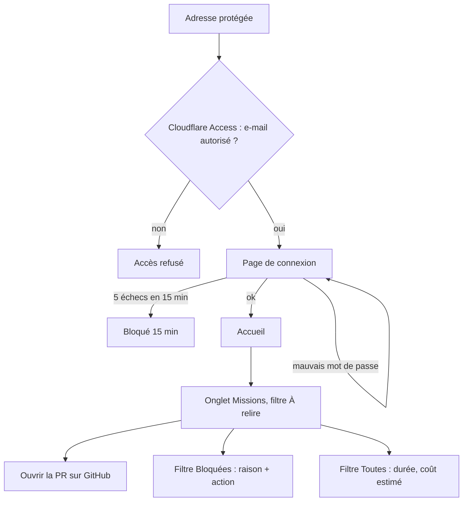

# APP_FLOW — Tableau de bord AgentImpact

Rédigé le 20/11/2026. **[LU]** existant dans le code ; **[NOUVEAU]** à construire.

L'outil est interne. Le parcours type « inscription → action de valeur → paiement » se lit ici comme « connexion → voir les missions → ouvrir la PR à relire ». Il n'y a ni inscription ni paiement (N/A, voir PRD).

## Écrans

| Écran | Chemin | Statut |
| --- | --- | --- |
| Portail Cloudflare Access (e-mail + code) | avant `/dashboard` | **[NOUVEAU]**, hors code |
| Connexion | `/dashboard/login.html` | **[LU]** (aujourd'hui en 404, à réparer) |
| Accueil : profils, policies, workflows | `/dashboard/` | **[LU]** |
| Onglet Missions : liste et filtres | `/dashboard/#missions` | **[NOUVEAU]** |
| Détail d'une mission (ligne dépliée) | même page | **[NOUVEAU]** |
| Workflows | `/dashboard/workflows.html` | **[LU]**, non servi, hors MVP |
| Séance sport | `/training` | **[LU]**, hors périmètre |

## Parcours principal

1. Nadir ouvre l'adresse protégée [À CONFIRMER : domaine] sur son Mac ou son téléphone.
2. Cloudflare Access lui demande son e-mail et un code. Sans e-mail autorisé, l'accès est refusé avant l'API.
3. Page de connexion : il saisit le mot de passe, puis le cookie de session est posé (8 h).
4. L'accueil s'ouvre ; il clique sur l'onglet « Missions ».
5. Le filtre « À relire » est actif par défaut : les PR ouvertes et non fusionnées, la plus ancienne en premier.
6. Il clique sur « Ouvrir la PR » pour la relire et la fusionner sur GitHub.
7. Le filtre « Bloquées » montre la raison en une phrase et ce qu'il faut faire.

## Parcours secondaires

- **Suivre une mission en cours** : filtre « En cours ». La ligne montre l'étape (plan, code, tests, relecture) et le temps écoulé.
- **Faire le point sur le coût** : filtre « Toutes ». Le total de la semaine (tokens et euros estimés) apparaît en haut.
- **Session expirée** : toute réponse 401 renvoie vers la connexion **[LU : app.js:15-18]**.
- **Approuver une action** (PRD indispensable 1), hors tableau de bord **[LU]** :
  1. un agent appelle `POST /actions` ou `POST /api/approvals/request` ;
  2. l'action est notifiée dans Slack ;
  3. Nadir approuve ou refuse, ce qui appelle `POST /api/approvals` (rôle admin, empreinte `payload_hash`) ;
  4. l'action passe à `approved` ou `rejected`.
- **Mission lancée par « go »** (PRD indispensable 2) **[LU]** :
  1. Nadir écrit « go AGE-xx » à Hermès dans Slack ;
  2. Hermès appelle `POST /missions` ;
  3. l'autopilote approuve si sa politique le permet, sinon la mission attend une approbation humaine ;
  4. l'exécuteur appelle `dispatch`, puis `PATCH /missions/:id/result` ;
  5. la mission apparaît dans l'onglet Missions (parcours principal).

## États par écran

| Écran | Vide | Chargement | Erreur |
| --- | --- | --- | --- |
| Connexion **[LU]** | — | bouton désactivé pendant l'envoi | « Mot de passe incorrect » ; « Trop d'essais, réessayez dans 15 min » **[NOUVEAU]** |
| Accueil **[LU]** | « Aucun profil / policy / workflow » | « Chargement… » dans chaque carte | Aujourd'hui une erreur s'affiche comme un état vide (`app.js:77-79`) : à corriger, un message « Impossible de charger » doit apparaître |
| Onglet Missions **[NOUVEAU]** | « Aucune mission à relire » (ou bloquée, ou en cours, selon le filtre) | squelette de 3 lignes | « Impossible de charger les missions » + bouton Réessayer. GitHub indisponible : état de PR « inconnu », la page reste utilisable |
| Détail d'une mission **[NOUVEAU]** | champs absents affichés « — » (jamais « None ») | — | « Détail indisponible » |

## Accès par rôle

| Rôle | Accès |
| --- | --- |
| Nadir (seul utilisateur) | lecture de tous les écrans du tableau de bord |
| Tokens agents (hermes, bridge…) | aucun accès aux écrans ; API seulement **[LU]** |
| Toute autre personne | arrêtée par Cloudflare Access |
